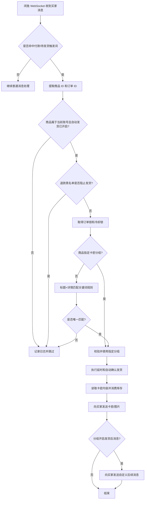

# 闲鱼自动发货与 AI 回复逻辑说明

本文档对应当前源码版本，帮助理解商品、卡密库存、自动发货和 AI 回复之间的关系。

## 一、核心概念

### 1. 商品

商品保存在 `item_info` 表中，唯一键是“闲鱼账号 `cookie_id` + 商品 ID `item_id`”。商品同步时会保存：

- 商品标题、价格、分类和详情
- 商品封面 `item_image`
- 是否多规格、是否按购买数量发货
- 商品级 AI 回复开关
- 商品级自动发货开关
- 指定卡密分组 `delivery_card_id`
- 商品级退款买家拉黑开关

商品级 AI 设置有三种状态：

| 页面显示 | 数据含义 | 实际行为 |
| --- | --- | --- |
| 跟随账号 | `ai_reply_enabled = NULL` | 使用账号级 AI 开关 |
| 开 | `ai_reply_enabled = 1` | 允许该商品进入 AI 回复流程，但账号仍需配置有效 AI |
| 关 | `ai_reply_enabled = 0` | 该商品不触发 AI 回复 |

旧商品的自动发货开关默认开启，以兼容原有关键词发货规则；新设置保存后，可以在商品卡片上关闭。

### 2. 卡密分组

当前数据库中的 `cards` 记录就是一个可发货的卡密分组，`name` 是分组名称，`type` 决定发货方式：

- `text`：固定文字
- `data`：批量库存，一行一条，发货后消费第一行
- `api`：调用外部接口动态取得卡密
- `image`：发送图片

在“卡密库存”中添加卡密时：

1. 选择“新建分组”并输入名称，会创建新的分组。
2. 选择已有分组，会把输入内容追加到该分组，不重复创建同名分组。
3. 分组类型决定内容字段；例如批量库存应选择“批量”。

“智能策略”的自动发货规则也使用分组下拉选择，不再需要手填卡密组 ID。

### 3. 自动发货规则

`delivery_rules` 是“商品标题/详情关键词 -> 卡密分组”的兼容规则。一个规则包含：

- 商品关键词
- 目标卡密分组
- 是否启用
- 多规格条件
- 发货次数统计

商品可以直接指定卡密分组。指定后优先使用该分组；商品没有指定分组时，才使用关键词规则。

## 二、自动发货完整流程

实际步骤如下：

1. 账号连接收到闲鱼消息后，程序识别“我已付款、等待你发货”等触发内容。
2. 提取商品 ID、订单 ID、买家 ID 和聊天 ID。
3. 验证商品属于当前账号，并检查商品“自动发货”开关。
4. 按全局退款黑名单/商品退款黑名单规则检查买家。命中且未列入白名单时直接跳过，避免误发卡密。
5. 以订单 ID 加锁，并检查 10 分钟冷却，防止同一订单重复处理。
6. 如果商品设置了卡密分组，校验该分组属于当前账号且已启用，然后直接使用。
7. 如果商品没有指定分组，使用商品标题和商品详情匹配发货规则。多规格商品还会匹配规格名称和值；匹配到多个规则时会停止发货，避免发错库存。
8. 执行卡密分组的延时设置，并按账号设置执行闲鱼订单确认发货。
9. 根据分组类型取得内容：批量库存消费一行，API 类型调用接口，图片类型发送图片，文本类型发送固定文字。
10. 发送成功后标记订单已发货、保存订单状态并保持订单锁一段时间。
11. 如果分组开启“发货后自动发消息”，再给买家发送配置的后续消息。
12. 外部通知渠道（邮件、钉钉、飞书等）是另一条通知链，不等于给买家发送的后续消息。

## 三、卡密库存消费规则

- 批量数据按换行拆分，空行忽略。
- 每成功发出一条批量数据，就从库存中移除一条。
- 商品开启“多数量发货”时，程序读取订单数量并循环消费对应数量；关闭时只消费一条。
- 库存为空、API 失败或图片地址为空时，不会伪造成功内容，会记录失败日志并发送失败通知。

## 四、发货后买家消息

卡密分组可以配置：

- 开关：是否发送后续消息
- 内容：发送给买家的文本

支持以下变量：

- `{ITEM_ID}`：商品 ID
- `{COUNT}`：本次发送的卡密数量
- `{CARD_GROUP}`：卡密分组名称

例如：`卡密已发送，请查收。本次发送 {COUNT} 条。`

## 五、AI 回复逻辑

1. 账号级 AI 设置提供模型、API 地址、API Key 和总开关。
2. 收到普通买家消息后，先判断商品级开关；商品关闭时直接跳过。
3. 商品处于“跟随账号”时使用账号级开关；商品开启时允许进入 AI 流程，但仍需要账号拥有有效模型配置和 API Key。
4. AI 使用数据库中的商品标题、价格、详情和商品专属关键词作为上下文。
5. AI 回复和自动发货是两条独立流程：买家付款触发自动发货，普通咨询触发 AI 回复，二者可以分别开关。

## 六、商品封面为什么会为空

闲鱼列表接口的图片字段在不同返回版本中可能叫 `picUrl`、`url` 或放在 `picList` 数组中。当前同步逻辑会：

1. 从这些字段中提取第一张封面。
2. 把 `//` 开头的地址补成 `https://`。
3. 单独保存到 `item_info.item_image`。
4. 旧版本已经保存到 `item_detail` 的商品，会在数据库迁移时自动回填封面字段。

如果某件商品仍没有封面，通常是闲鱼接口没有返回图片或图片地址已失效；重新同步该账号后可以再次尝试获取。

## 七、推荐配置顺序

1. 先在“卡密库存”建立分组，并导入批量卡密。
2. 编辑分组，设置延时和发货后买家消息。
3. 在“商品管理”同步商品，确认封面和标题正常。
4. 对需要发卡的商品打开“自动发货”，并选择对应卡密分组。
5. 对需要 AI 的商品选择“跟随账号”或“开”，再到账号 AI 设置中完成 API 配置和测试。
6. 只有需要关键词兜底或多规格匹配时，才在“智能策略”中增加发货规则。
7. 使用测试账号下单验证，确认买家收到卡密、后续消息和订单状态均正确后，再启用真实账号。

## 八、排查入口

- 商品同步/封面：查看商品同步日志和 `item_info.item_image`。
- 自动发货匹配：搜索日志中的“唯一匹配发货规则”“商品已指定卡密分组”。
- 库存问题：检查卡密分组类型、启用状态和批量数据剩余行数。
- 重复发货：检查订单 ID、订单锁、冷却日志和 `system_shipped` 状态。
- AI 不回复：依次检查商品开关、账号 AI 开关、模型、API 地址和 API Key。
